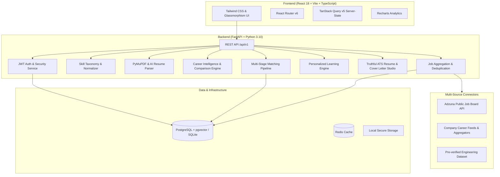

# CareerMap AI — AI-Powered Career Discovery & Application Copilot

CareerMap AI is an enterprise-grade, AI-first career discovery, personalized job matching, truthful resume tailoring, learning roadmap, and application tracking platform.

Unlike generic CRUD apps with chatbot widgets added as an afterthought, CareerMap AI integrates structured AI pipelines across candidate profiling, skill taxonomy normalization, multi-stage hybrid retrieval, explainable match scoring, truthful resume tailoring, and real-time application analytics.

---

## Architecture Overview



---

## Core Modules Implemented

### Module A: Authentication & Candidate Profile
- JWT-based authentication with bcrypt password hashing and token refresh.
- Resume upload supporting PDF and DOCX formats.
- Text extraction using PyMuPDF and AI extraction into structured schema: contact info, summary, verified skills, employment history, projects, and education.
- Candidate review and editing UI with live completeness calculation.

### Module B: AI Career Intelligence
- Evaluates candidate profile and recommends best-fit career paths (Software Development Engineer, Backend Developer, Full-Stack Engineer, AI/ML Engineer, DevOps, etc.).
- Transparent role scoring with fit rationale, demonstrated skills, and missing competencies.
- Interactive multi-role comparison engine.

### Module C: Multi-Source Job Discovery
- Extensible `BaseJobConnector` architecture with `ConnectorRegistry`.
- First real connector: **Adzuna API** integration with query, location, employment type, and salary filtering.
- Automatic canonical key deduplication (`canonical_key`), freshness verification, and connector health monitoring in Settings.

### Module D: Multi-Stage AI Matching Pipeline
- **Stage 1**: Hard eligibility & preference filters (location, work mode, minimum experience).
- **Stage 2**: Skill taxonomy normalization mapping aliases (e.g. `['reactjs', 'react.js'] -> 'React'`).
- **Stage 3**: Structured & semantic retrieval.
- **Stage 4**: Documented scoring model combining required skills, preferred qualifications, experience seniority, and candidate preferences.
- **Stage 5**: Explainable evidence panel returning exact quotes from the candidate's profile supporting every requirement.

### Module E: Personalized Learning Roadmap
- Identifies missing skills for target roles.
- Curates week-by-week schedule tailored to candidate's weekly availability (5 to 20 hours/week).
- Verified resource URLs (official documentation, MDN, freeCodeCamp, Coursera) and practical milestone projects.
- Interactive progress checklist.

### Module F: AI Resume & Cover Letter Studio
- Tailors resumes and cover letters for specific job postings.
- **Strict Anti-Hallucination Guarantee**: Only reorganizes and emphasizes genuine candidate facts; never fabricates employers, dates, or credentials.
- In-browser live preview with one-click print/PDF export.

### Module G: Application Assistant & Pipeline Tracker
- Kanban pipeline tracker: `Saved` → `Ready to Apply` → `Applied` → `Interview` → `Offer` → `Rejected`.
- Records transition audit trail with status history, interview dates, and notes.
- Direct links to official application portals.

### Module H: Career & Application Analytics
- Real-time Recharts visualizations built directly from database records.
- Funnel distribution and application conversion rates.
- Aggregated top competency gaps across matched jobs.

---

## Technical Stack

| Layer | Technologies |
|---|---|
| **Frontend** | React 18, Vite, TypeScript, Tailwind CSS, TanStack Query v5, React Router v6, Recharts, Lucide Icons |
| **Backend** | Python 3.10+, FastAPI, Pydantic v2, SQLAlchemy 2.x, Alembic, SQLite / PostgreSQL (pgvector) |
| **AI Services** | Google Gemini API (`gemini-1.5-flash`), PyMuPDF (fitz), Structured JSON validation |
| **Data & Storage** | PostgreSQL with pgvector, Redis, Local secure file storage |
| **DevOps** | Docker, Docker Compose, Nginx, GitHub Actions CI |

---

## Quickstart Guide (Local Development in 2 Minutes)

### Prerequisites
- Node.js 18+ & npm
- Python 3.10+

### 1. Backend Setup
```bash
cd backend

# Create and activate virtual environment
python3 -m venv venv
source venv/bin/activate  # On Windows: venv\Scripts\activate

# Install dependencies
pip install -r requirements.txt

# Create .env from template (defaults to local SQLite for instant setup)
cp .env.example .env

# Seed initial verified engineering jobs
python app/seed.py

# Run tests to verify setup
pytest -v

# Start FastAPI backend server
uvicorn app.main:app --reload --port 8000
```
Backend API will be running at `http://localhost:8000`. OpenAPI documentation available at `http://localhost:8000/api/v1/docs`.

### 2. Frontend Setup
In a new terminal:
```bash
cd frontend

# Install dependencies
npm install

# Start Vite development server
npm run dev
```
Open `http://localhost:5173` in your browser.

---

## Docker Compose Deployment

To deploy the entire production stack (PostgreSQL with pgvector, Redis, FastAPI, and Nginx frontend):

```bash
# 1. Copy environment template
cp .env.example .env

# 2. Build and launch all containers
docker-compose up --build -d

# 3. View logs
docker-compose logs -f
```

The application will be accessible at `http://localhost`.

---

## External Connectors & API Keys Configuration

Edit `backend/.env` (or root `.env` for Docker):

| Variable | Description | Where to Obtain |
|---|---|---|
| `GEMINI_API_KEY` | Google Gemini API key for structured resume extraction & roadmap generation | [Google AI Studio](https://aistudio.google.com/app/apikey) |
| `ADZUNA_APP_ID` | Application ID for live Adzuna job search API | [Adzuna Developer Portal](https://developer.adzuna.com/) |
| `ADZUNA_APP_KEY` | Application Key for live Adzuna job search API | [Adzuna Developer Portal](https://developer.adzuna.com/) |

*(Note: The platform functions immediately with verified pre-seeded jobs even before external keys are configured!)*

---

## Testing Suite

Run the automated backend test suite:
```bash
cd backend
source venv/bin/activate
pytest -v
```

Tests included:
- `test_auth.py`: User registration, duplicate rejection, JWT authentication, and protected endpoints.
- `test_skill_normalizer.py`: Deterministic canonical skill mapping and category classification.
- `test_matching_engine.py`: Multi-stage matching score computation, skill overlap, and evidence extraction.
- `test_jobs.py`: Multi-criteria search filters, keyword queries, and work mode filters.
- `test_e2e_workflow.py`: Full end-to-end candidate lifecycle (register → profile → ingest job → matching → application tracking → analytics).

---

## API Reference (`/api/v1`)

- `POST /auth/register` — Register candidate account
- `POST /auth/login` — Authenticate and receive JWT tokens
- `GET /auth/me` — Current authenticated user details
- `GET /profile` — Retrieve candidate profile
- `PUT /profile` — Update candidate profile
- `POST /profile/skills` — Add verified skill
- `POST /profile/resume/upload` — Upload resume PDF/DOCX
- `POST /profile/resume/{id}/extract` — Extract profile facts with AI
- `GET /jobs` — Multi-source job search with filters and pagination
- `GET /jobs/{id}` — Job listing details
- `GET /jobs/sources` — Connector status and health report
- `POST /jobs/sync` — Trigger external connector ingestion
- `POST /matching/run` — Run multi-stage AI matching engine
- `GET /matching/job/{id}` — Match explanation & evidence breakdown
- `GET /career/recommendations` — AI career path analysis
- `POST /career/compare` — Compare target roles side-by-side
- `GET /learning` — List personalized learning roadmaps
- `POST /learning/generate` — Generate AI learning roadmap
- `PUT /learning/items/{id}` — Mark curriculum competency completed
- `POST /documents/resume` — Generate truthful tailored ATS resume
- `POST /documents/cover-letter` — Generate personalized cover letter
- `GET /applications` — List tracked applications
- `PUT /applications/{id}/status` — Advance application stage with audit note
- `GET /analytics` — Real-time candidate analytics & funnel metrics
